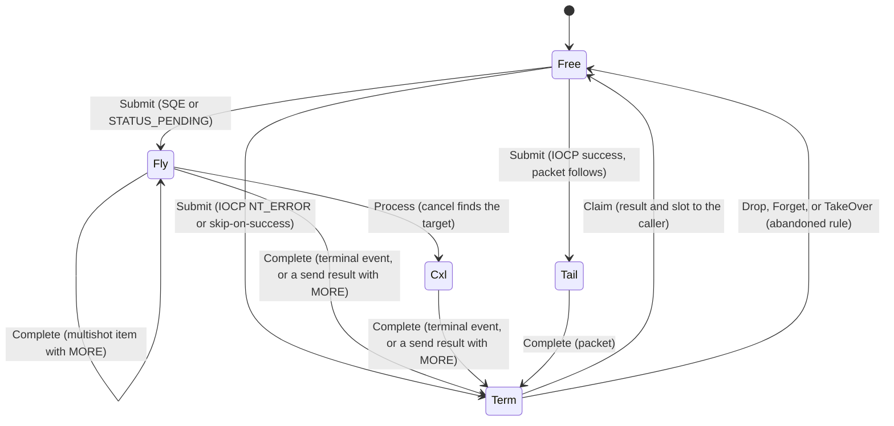

# Operation ownership: statecharts

These charts come from `OperationOwnership.tla`. The checked model is the authority; the charts
only show its shape. Each label names the action of the model, or the operator that the action
calls: `Submit` is the part of `BeginRx`, `BeginTx`, and `BeginAc` that gives the operation to the
kernel.

## The life of one operation

One slot holds one operation from its accepted submission to its terminal event. `Fly`, `Cxl`,
and `Tail` are the live states (`st = "live"`), named by what the kernel can still deliver (`k`).
`Tail` is the IOCP packet after an immediate return.

## The backing of a zero-copy send

A send result with `IORING_CQE_F_MORE` ends the send and frees its slot, and its backing joins
the stream's pending notices (`pn`, `bk = "zc"`). Each pending notice has this life, apart from the
slot. `Detached` is a pending notice after close returned (`dt`), and `Purged` is the same state
after a reset (`dt` and `pg`).

```mermaid
stateDiagram-v2
  [*] --> Pending: Complete (send result with MORE)
  Pending --> Released: Notice (peer acknowledges)
  Pending --> Detached: CloseDone (close returns; the whole set detaches)
  Detached --> Released: Notice (peer acknowledges)
  Detached --> Purged: Reset (drain limit, budget pressure, or grace expiry)
  Purged --> Released: Notice (from the kernel)
  Released --> [*]
```

## Runtime, task, resources, and workers

The four regions run at the same time.

```mermaid
stateDiagram-v2
  state Lifecycle {
    [*] --> Run
    Run --> Down: Shutdown
    --
    [*] --> Alive
    Alive --> Gone: EndTask
    --
    [*] --> Open
    Open --> Closing: EndTask (cancel each live operation)
    Closing --> Closed: CloseDone (each slot is free; pending notices detach)
    --
    [*] --> Running
    Running --> Exited: Exit (no held slot and no pending notice at this home)
  }
```

## What the charts hide or merge

- A terminal event with no waiting future goes from a live state directly to `Free`: the
  abandoned rule applies in the same step. The chart shows only the path through `Term`.
- The fairness. `Fly` has no fairness: the peer controls it. `Cxl` and `Tail` end under weak
  fairness. `Pending` and `Detached` wait for the peer, so they have no fairness. `Purged` ends
  under weak fairness. `Reset` is fair while the runtime runs (the drain limit) and after
  `Shutdown` (grace expiry); under budget pressure it has no fairness.
- One `Reset` moves every detached notice of the stream to `Purged` at once.
- The pending notices exist only for the stream's send on io_uring. The claim of a zero-copy send
  returns its progress, not its backing, so `Claim` and the abandoned rule do not release a
  backing that a notice releases.
- The request entries (`rq`), the cancel flag (`cx`), and the generation check are not shown. A
  stale request removes itself and changes nothing.
- The data is not shown: the received bytes (`rbuf`, `held`, `got`), the send progress (`tp`,
  `wd`, `rep`), the connections (`kc`, `ar`, `hc`, `uc`), each backing (`bk`), and the home of
  each pending notice (`nh`).
- The futures (`fut`) and the waker (`wake`, `woke`) are not shown. `Repoll` changes only the
  waker.
- `Shutdown` merges the request and grace expiry. `EndTask` merges the drop of each future, the
  close of each resource, and the selection of the home of each held slot and each pending
  notice.
- The guards are not shown. `Exit` needs `Down`, `Gone`, no held slot at its home, and no pending
  notice at its home. `CloseDone` needs each slot of the resource to be free. `Notice` needs the
  home of the notice to run. `EndTask` happens
  at any time while the runtime runs, and it is fair after `Shutdown`.
- The branches of the known-bad variants (`Bug`) are not shown.
